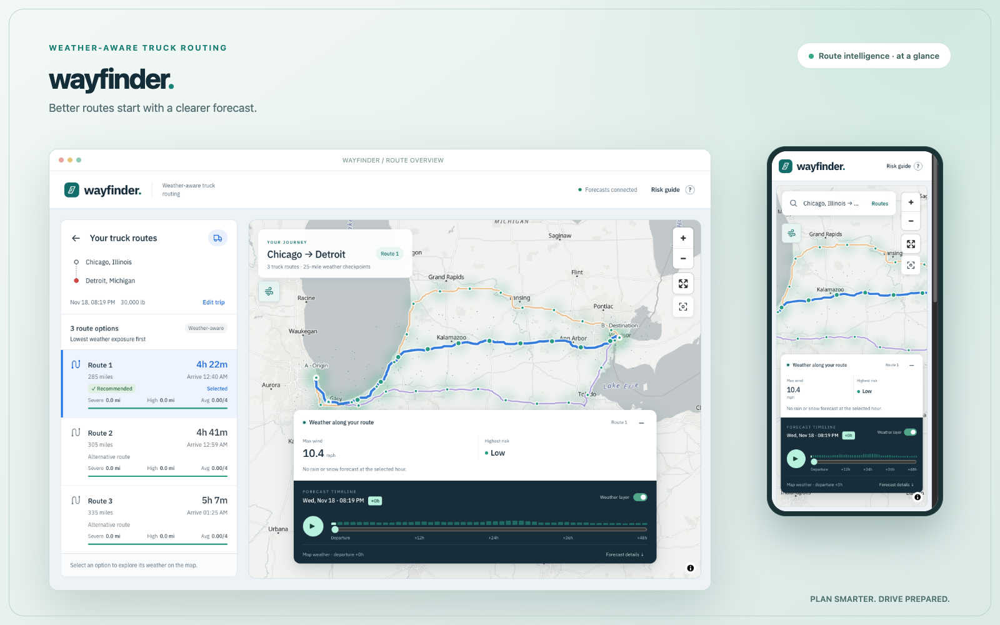

<div align="center">

# Wayfinder

**Weather-aware truck routing for clearer, more confident trip planning.**

[Open the live app](https://weather-routing.fahad288ali.workers.dev) · [Getting started](#getting-started) · [How risk works](#how-risk-works) · [API reference](#api-reference)



</div>

Wayfinder compares truck routes using forecast conditions at the time a driver is expected to reach each checkpoint. It combines TomTom routing, Open-Meteo weather, and a transparent risk policy in a responsive React and Django application.

## What it does

- **Compare up to three routes** with travel time, distance, and weather-risk summaries. TomTom may return fewer alternatives for some trips.
- **Check weather along the road** at 10, 25, or 50-mile intervals, using each checkpoint's estimated arrival time.
- **Recommend a route** by prioritizing fewer Severe miles, fewer High miles, lower distance-weighted average risk, and then shorter travel time.
- **Explore the next 48 hours** on a map with an interactive forecast timeline, colored checkpoints, and optional wind animation.
- **Plan from any screen** with a map-first mobile layout, route comparison, and a checkpoint detail table.
- **Handle missing weather honestly:** unavailable forecasts remain Unknown; routes with Unknown or No Travel conditions are not recommended.

## How it works

1. Enter an origin, destination, departure time, cargo load, and checkpoint spacing.
2. Django geocodes both locations and requests truck-capable route alternatives from TomTom.
3. Checkpoint positions and ETAs are interpolated from route geometry and cumulative travel times.
4. Open-Meteo forecasts are sampled at each ETA. Wind, rain, snow, and cargo are evaluated using the policy below.
5. Each mile is assigned to one checkpoint interval. Eligible routes are ranked, then displayed on the map.

The forecast slider shows conditions across the corridor at the selected hour after departure. **It does not change route scores**: those use each checkpoint's arrival-time forecast. Forecasts are estimates, and conditions can change between checkpoints.

## How risk works

Each checkpoint receives the highest applicable risk from wind, rain, snow, and cargo. Rain includes large-scale rain and showers; snowfall is forecast snow depth per hour.

| Risk | Wind (mph) | Rain (in/hr) | Snow (in/hr) |
| --- | ---: | ---: | ---: |
| Low | < 25 | < 0.10 | < 0.5 |
| Moderate | 25–<35 | 0.10–<0.25 | 0.5–<1 |
| High | 35–<45 | 0.25–<0.50 | 1–<2 |
| Severe | 45–<55 | 0.50–1.00 | 2–3 |
| No Travel | ≥ 55 | > 1.00 | > 3 |

**Cargo adjustments:** wind of at least 45 mph with cargo over 30,000 lb is No Travel; wind of at least 35 mph with cargo over 40,000 lb is at least Severe. Wind at or above 55 mph is No Travel for every load. At overlapping precipitation boundaries, the higher category applies. Cargo load affects weather risk; it is not used as a substitute for the truck's gross vehicle weight.

Routes with any No Travel or Unknown checkpoint are excluded from recommendation. Remaining routes are ranked lexicographically by Severe miles, High miles, distance-weighted average risk (Low = 0 through No Travel = 4), and duration.

## Technology

| Layer | Tools |
| --- | --- |
| Frontend | React, TypeScript, Vite, MapLibre GL JS |
| Backend | Django, Python, uv |
| Routing and geocoding | TomTom Routing and Geocoding APIs |
| Forecasts | Open-Meteo |
| Map tiles | OpenFreeMap, OpenMapTiles, OpenStreetMap |
| Hosting | Cloudflare Python Workers, static assets, and D1 |

The app uses the free Open-Meteo endpoint for this noncommercial demo; verify provider terms and quotas before commercial use. A route is not guaranteed to have three alternatives, and free hosting limits may affect long or complex trips.

## Getting started

### Requirements

- Python 3.13 and [uv](https://docs.astral.sh/uv/)
- Node.js and [pnpm](https://pnpm.io/installation) (the project declares pnpm 12.3.4)
- A TomTom API key with routing and geocoding access

### 1. Configure the backend

```bash
cd backend
uv sync --frozen
cp .env.example .env
```

Edit `backend/.env` and set `TOMTOM_API_KEY`. Keep this file private; it is ignored by Git. Start Django:

```bash
uv run python src/manage.py runserver 127.0.0.1:8000
```

### 2. Start the frontend

In a second terminal:

```bash
cd frontend
pnpm install --frozen-lockfile
pnpm dev --host 127.0.0.1
```

Open [http://127.0.0.1:5173](http://127.0.0.1:5173). Vite forwards `/api` requests to the local Django server. Choose **Try Chicago → Detroit** to fill the form, then select **Compare routes**.

## API reference

All endpoints are served from the same origin. POST requests accept JSON.

| Method | Endpoint | Purpose |
| --- | --- | --- |
| GET | `/api/status/` | Report whether routing is configured. |
| GET | `/api/health/` | Production Worker health check. |
| GET | `/api/ready/` | Production D1 connectivity check. |
| POST | `/api/routes/` | Resolve locations and return route geometry and checkpoint ETAs. |
| POST | `/api/forecast/` | Return arrival-time weather and 49 hourly frames for up to 12 checkpoints. |
| POST | `/api/rank/` | Summarize checkpoint risks and recommend an eligible route. |

Example route request (replace the departure with an ISO 8601 time in the next 48 hours):

```json
{
  "origin": "Chicago, Illinois",
  "destination": "Detroit, Michigan",
  "departure": "2026-11-18T14:00:00Z",
  "load_lb": 30000,
  "spacing": 25
}
```

The frontend requests forecast batches with up to four in flight. Opt in to a server timing breakdown for `/api/routes/` and `/api/forecast/` by sending `X-Performance-Debug: 1`; timings are returned in the `Server-Timing` response header. The API contract is documented in [docs/openapi.json](docs/openapi.json).

## Development and checks

```bash
# Backend
cd backend
uv run python src/manage.py check
uv run pytest -q
uv run ruff check src/trips src/integrations tests

# Frontend
cd ../frontend
pnpm build
pnpm lint
node --experimental-strip-types --test tests/api.test.ts tests/forecast.test.ts tests/wind.test.ts
```

After changing the OpenAPI contract, regenerate the frontend types with `pnpm api:types` from `frontend/`. See [hosting](docs/hosting.md) for Cloudflare configuration and [API providers](docs/api-providers.md) for the provider decision.

## Project layout

```text
backend/
  src/config/       Django settings, URLs, and Cloudflare configuration
  src/integrations/ TomTom and Open-Meteo clients
  src/trips/        Trip orchestration, checkpoint sampling, and risk policy
  src/worker.py     Cloudflare Python Worker entry point
  tests/            Backend tests
frontend/
  src/features/     Trip planner, route results, and weather map
  src/lib/          API client and generated types
  tests/            Forecast, wind, and API orchestration tests
docs/               Architecture, hosting, provider notes, and preview image
```

## Data and attribution

Routing data © TomTom. Weather forecasts by [Open-Meteo](https://open-meteo.com/). Map tiles by [OpenFreeMap](https://openfreemap.org/), with map data © [OpenStreetMap contributors](https://www.openstreetmap.org/copyright) and OpenMapTiles. Map credits are available from the information control on the map.
